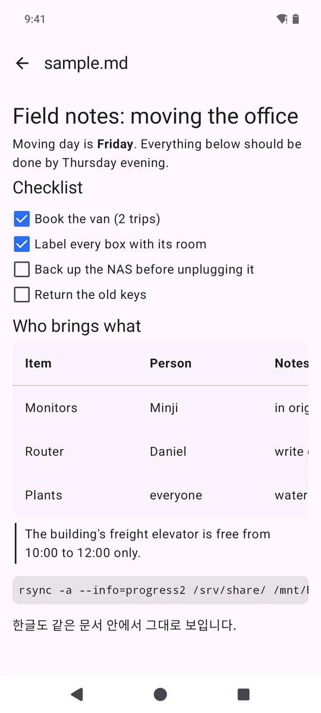
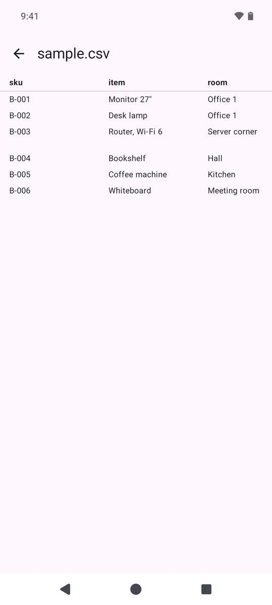
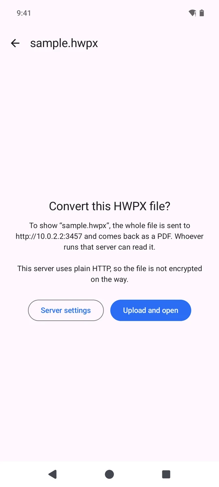
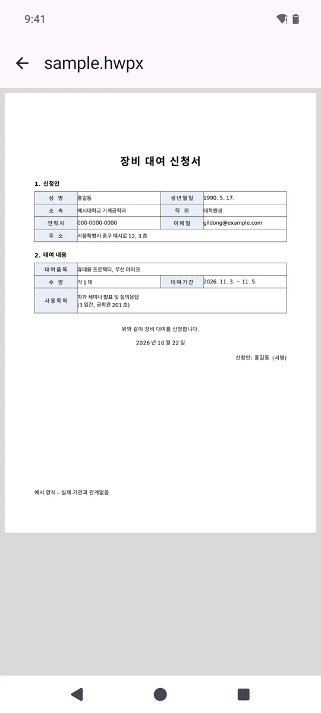
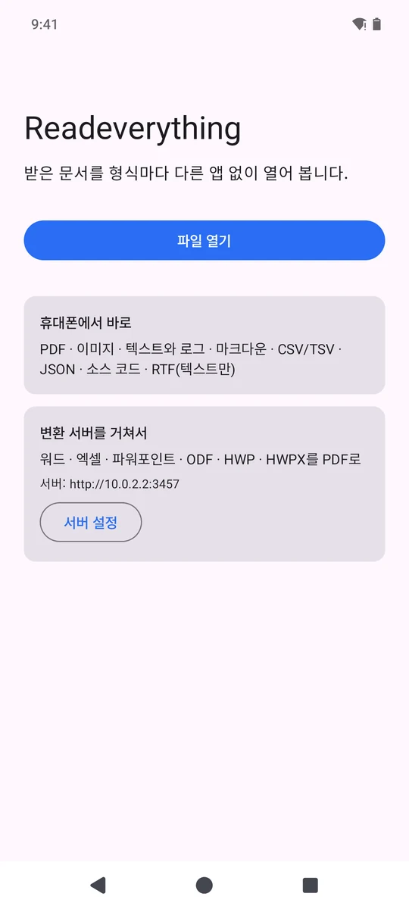

# Readeverything

An Android viewer for the documents people send you: PDF, Markdown, CSV, JSON, source code and plain text open on the phone, and Word, Excel, PowerPoint and Korean HWP/HWPX files are converted to PDF by a small server you run yourself.

<p>




</p>

In Korea a lot of paperwork still arrives as `.hwp` or `.hwpx`, and on a phone that usually means installing the Hancom viewer next to a PDF app, an Office app and a text editor. I wanted one "Open with" target that figures out what a file actually is and shows it.

[한국어 설명은 아래에 있습니다.](#한국어)

## How it works

Every file goes through `ViewerActivity`, which looks at its first bytes before trusting the name or MIME type (content URIs often arrive as `application/octet-stream`). OLE2 files are checked for the HWP 5 header, and ZIP files are opened and their entry names read, with a cap on entries and inflated bytes, to tell HWPX, DOCX, PPTX, XLSX, ODF and EPUB apart. When the bytes don't settle it, the extension does; it is best effort, not a full format parser.

| Format | Where | How |
|---|---|---|
| PDF | phone | `PdfRenderer`, pages rendered lazily at screen width, pinch to zoom |
| PNG, JPEG, WebP, GIF, BMP, SVG | phone | Coil 3 |
| Text, logs | phone | UTF-8 with a CP949 fallback for Korean files saved by Excel or Notepad |
| Markdown | phone | multiplatform-markdown-renderer (GFM: tables, task lists) |
| JSON | phone | collapsible tree (files over 4 MB as formatted text) |
| CSV, TSV | phone | own RFC 4180-style parser (first 20,000 rows, 200 columns), tap a cell to see all of it |
| Source code | phone | syntax highlighting (snipme highlights) up to 300 KB, plain text above |
| RTF | phone | text only (rtfparserkit) |
| DOC, DOCX, XLS, XLSX, PPT, PPTX, ODT, ODS, ODP | your server | LibreOffice → PDF |
| HWP, HWPX | your server | LibreOffice + [H2Orestart](https://github.com/ebandal/H2Orestart) → PDF |

**Nothing leaves the phone without asking.** A file that needs the server shows where it will be sent and waits for "Upload and open". The PDF that comes back is cached by the file's SHA-256, so opening the same file again needs no upload (until Android clears the app's cache). The server address is checked when you save it (no credentials, query strings or fragments in the URL), connections to an `http://` address are refused unless "Allow unencrypted HTTP" is on, and redirects are not followed. The token is sent as a bearer header; app backups are off.

## Run the app

Open the project in Android Studio, or build from the command line (JDK 17+, Android SDK with platform 36):

```sh
./gradlew :app:assembleDebug        # app/build/outputs/apk/debug/app-debug.apk
./gradlew :app:testDebugUnitTest    # type detection, CSV, text decoding, server URLs
```

minSdk 28, targetSdk 36. The on-device formats in the table above work without a server; Office and HWP files then show a screen that leads to the server settings.

## Run the conversion server

`server/convert_server.py` is a small Flask app around `soffice --headless --convert-to pdf`. It needs a token, converts one file at a time on its own LibreOffice profile, lets two more conversions wait and answers 503 to the rest (uploads are received before that check), kills the whole LibreOffice process group on timeout, checks the PDF header of the result, sends `Cache-Control: no-store`, and deletes each request's input and output files; only the LibreOffice profile stays.

With Docker:

```sh
cd server
export CONVERT_TOKEN=$(openssl rand -base64 24)
docker compose up -d --build        # listens on 127.0.0.1:3000
```

The image is Ubuntu's LibreOffice plus H2Orestart 0.7.13, downloaded at build time and checked against its SHA-256. The compose file keeps the container read-only with size-capped tmpfs for scratch space. I haven't built the image on this machine yet; the server itself was tested natively with the same LibreOffice and H2Orestart versions. For a phone on another network, put a TLS reverse proxy (Caddy, nginx) in front and use the `https://` address in the app; the address may include a path prefix.

Without Docker (Ubuntu): `sudo apt install libreoffice-writer libreoffice-calc libreoffice-impress libreoffice-java-common fonts-noto-cjk`, then `pip install -r server/requirements.txt` and `CONVERT_TOKEN=... python3 server/convert_server.py`. For HWP/HWPX, add H2Orestart to the server's profile once: `unopkg add -env:UserInstallation=file://$PWD/work/profile H2Orestart.oxt`.

Settings are environment variables: `CONVERT_MAX_MB` (default 50), `CONVERT_TIMEOUT` (120 s), `CONVERT_QUEUE` (2), `CONVERT_WORKDIR`, `HOST`, `PORT`. Tests: `pip install pytest && python -m pytest server/tests` (conversions are skipped when LibreOffice isn't installed; `CONVERT_TEST_HWP=1 CONVERT_TEST_WORKDIR=...` also runs the HWPX one).

LibreOffice parses whatever it is given, and the container can still reach the network. Run the server for yourself or people you trust and keep it away from other internal services.

## Limitations

- EPUB is recognised but not rendered.
- Office and HWP files become PDFs: no editing, and layout depends on LibreOffice and the fonts on the server.
- Text-like files are read into memory, with limits (16 MB for text, 4 MB for Markdown, 48 MB for uploads, 512 MB for PDFs).
- Tested on an Android 15 emulator (API 35) and, before these changes, on a Galaxy S22. Pinch zoom is implemented but was not exercised in the emulator.
- The screenshots use the sample files in `samples/` and a local server reached from the emulator at `10.0.2.2`.

## License

The app and the server are MIT, see [LICENSE](LICENSE). H2Orestart, which the Docker image downloads, is GPL-3.0. Libraries used by the app are listed in `app/build.gradle.kts` with their own licenses (Apache-2.0 for most).

---

## 한국어

받은 문서를 형식마다 다른 앱 없이 열어 보는 안드로이드 뷰어입니다. PDF·마크다운·CSV·JSON·코드·텍스트는 폰에서 바로 열고, 워드·엑셀·파워포인트와 한글(HWP/HWPX) 파일은 직접 띄운 변환 서버에서 PDF로 바꿔서 보여 줍니다.

- 파일 이름이나 MIME 타입보다 실제 바이트를 먼저 봅니다. 확장자가 없거나 `application/octet-stream`으로 와도 HWP·HWPX·DOCX를 구분합니다.
- 서버로 보내야 하는 파일은 어디로 보내는지 보여 주고 "업로드하고 열기"를 누를 때만 보냅니다. 한 번 변환한 파일은 내용 해시로 캐시해서 다시 열 때는 업로드하지 않습니다.
- 서버는 `server/`에 있습니다. 토큰이 필수이고, 한 번에 하나씩 변환하며, 요청마다 입력·출력 파일을 지웁니다(LibreOffice 프로필만 남음). HWP/HWPX는 LibreOffice용 H2Orestart 확장으로 변환합니다.
- CP949(EUC-KR)로 저장된 한글 텍스트·CSV도 자동으로 읽습니다.


